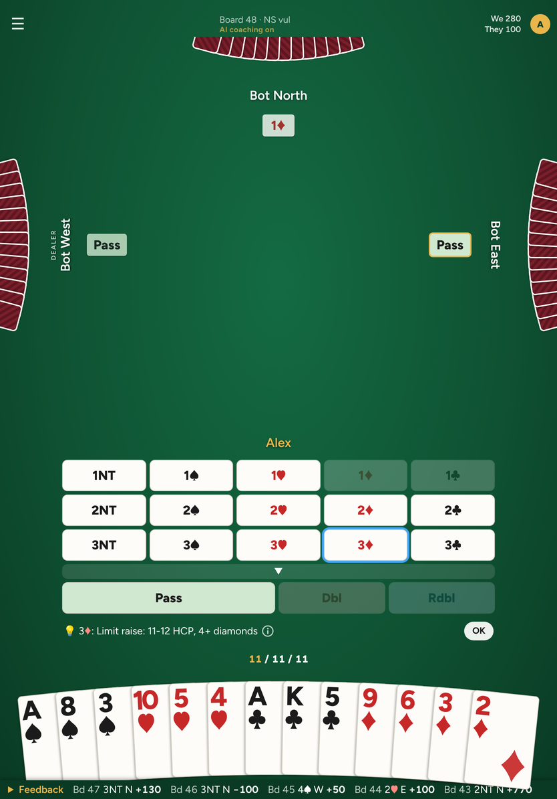
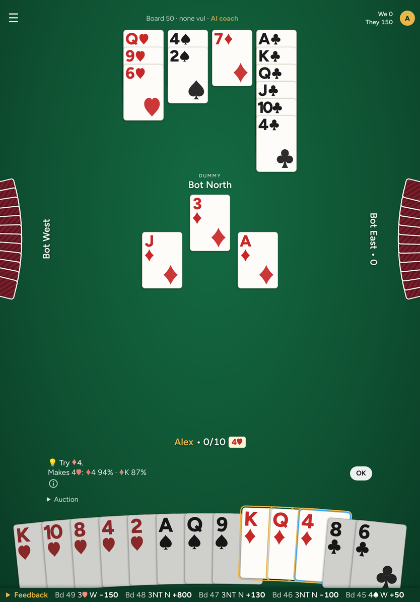
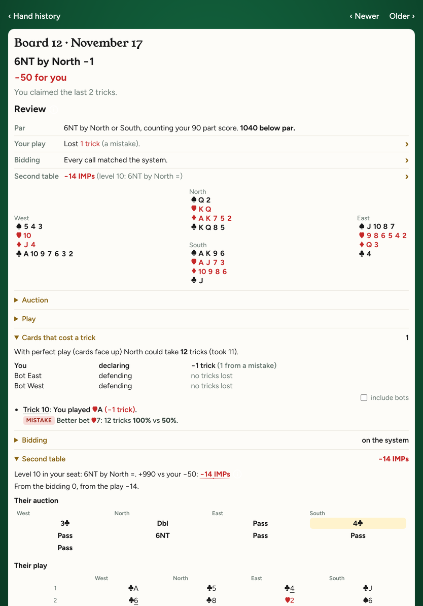
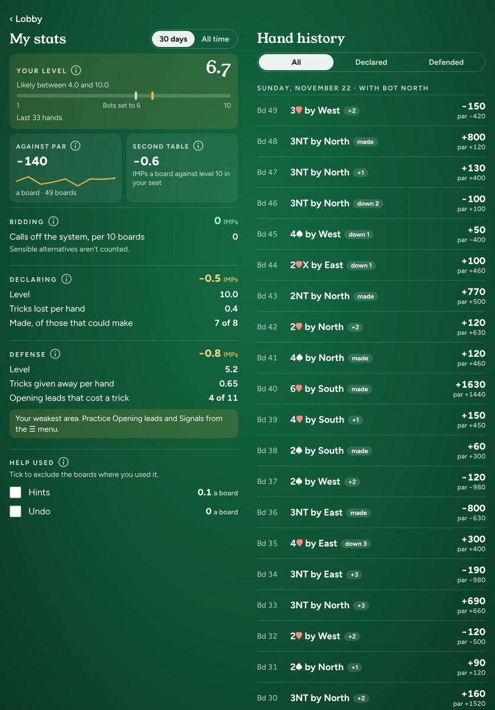
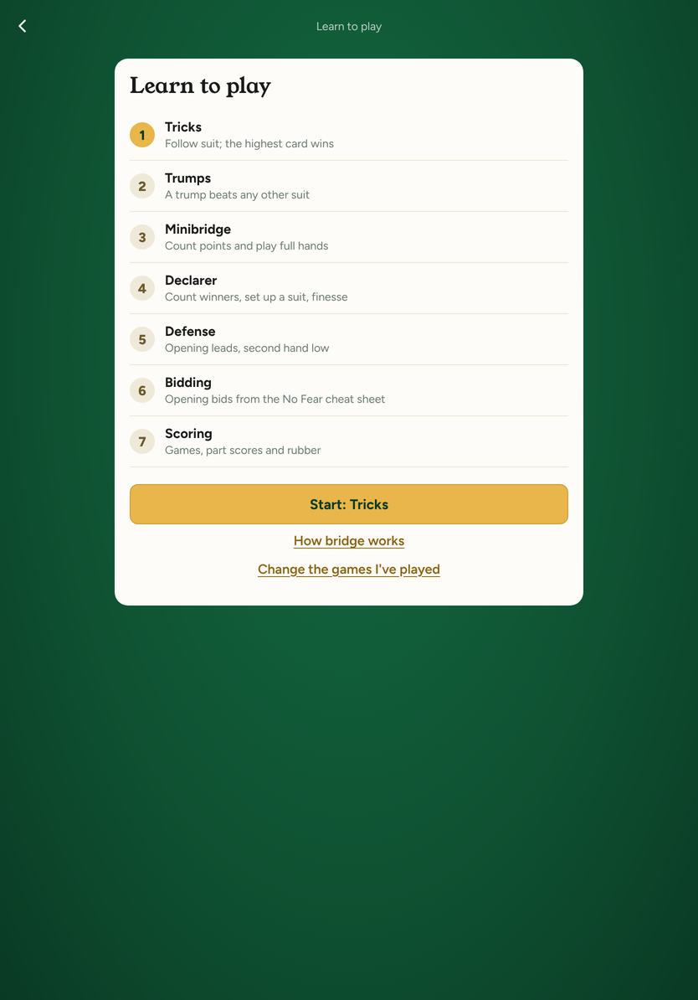
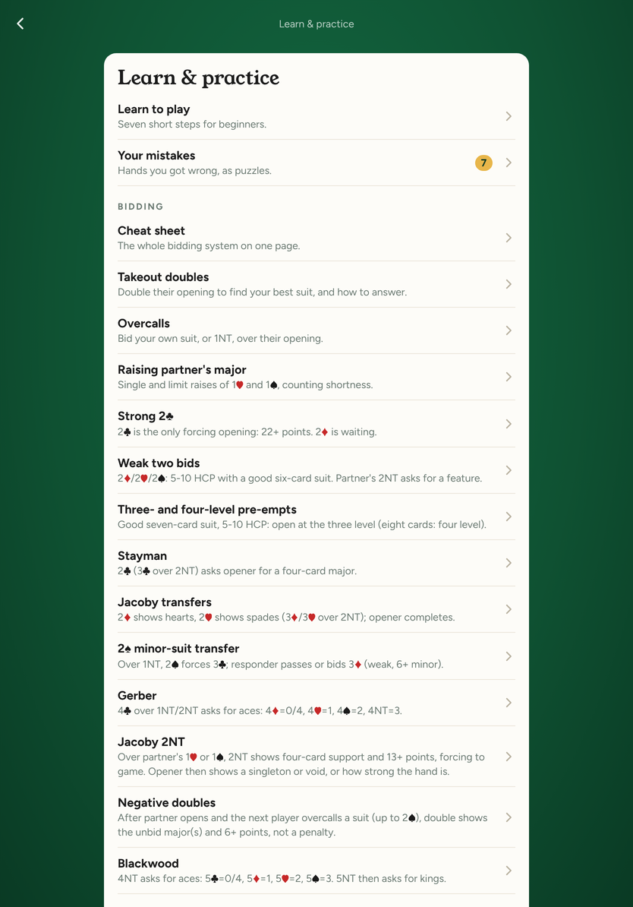

# Bridge

A contract bridge app for playing with friends and bots on phones and tablets. Up to four people sit at a table and
bots fill the empty seats. The bidding follows the
[No Fear Bridge cheat sheet](https://www.nofearbridge.com/bridge_bidding_cheat_sheet.pdf) (Standard American, 15-17
1NT, 5-card majors), and the app is built to help you get better: hints, a review after every board, lessons, and an
AI coach you can connect.

## Screenshots

On an iPad, from a demo account (the player and the bots' names are made up).

<table>
  <tr>
    <td width="33%"></td>
    <td width="33%"></td>
    <td width="33%"></td>
  </tr>
  <tr>
    <td align="center"><b>Bidding</b>, with a hint</td>
    <td align="center"><b>Card play</b>, with a hint and its odds</td>
    <td align="center"><b>Review</b> of a board, with the second table</td>
  </tr>
  <tr>
    <td width="33%"></td>
    <td width="33%"></td>
    <td width="33%"></td>
  </tr>
  <tr>
    <td align="center"><b>My stats</b> and hand history</td>
    <td align="center"><b>Learn to play</b></td>
    <td align="center"><b>Learn &amp; practice</b></td>
  </tr>
</table>

## What it does

- **Tables:** start a table and invite friends with a link. Up to four people pick their seats; bots play the rest.
  Anyone else can watch. The home screen lists every table you're still seated at, to go back to or quit.
- **Bidding:** one-tap bid buttons, your points at a glance, and every call can be tapped for what it means.
- **Card play:** claims (yours and the bots'), undo, rubber or duplicate scoring, Standard opening leads and
  optional defensive signals.
- **Bots** play at a strength from 1 to 10. They bid by the system's rules and play by trying many possible layouts of
  the hidden cards and solving each one with a double-dummy solver, never peeking at hidden hands. Tap a bot's call
  or card to see why.
- **Learning:** Learn to play for newcomers (seven short steps, skipping what you know from games like Hearts or
  Spades) and a lesson with practice deals for each convention, for opening leads and for signals, all on one Learn &
  practice page from the home screen; and hints: the system's call, or a card with how often it makes or beats the
  contract.
- **Review after every board:** a few lines sum the board up (par, your play, your bidding, the second table) above
  the four hands, and each opens in full:
  - **Cards that cost a trick**, found by solving the deal with every card seen, each marked **Mistake** (the worse
    bet at the time, with the odds of both cards on the layouts you could see) or **Unlucky** (a good bet that the
    cards beat). It also notes a trick the other side gave back.
  - **Bidding:** every call that left the system, marked **Helped** or **Cost** in points, judged over many deals like
    this one, with a note such as "No harm this time" when this deal went the other way.
  - **Second table:** the same deal played again with the strongest bot in your seat and the other seats as they
    were, as at a team match. You see its contract, auction and play, and your result against it in IMPs, split into
    what came from the bidding and what came from the play.
  - The auction, the play trick by trick, and the tricks with all cards seen.
  - **Play on from here** under each of your cards that cost a trick, and **Play this deal again**, with the real
    cards and bots in the other seats.
- **Your mistakes:** your own past Mistake cards and Cost calls come back as one-decision puzzles at the table. Pick
  a card or call and see whether it was right, with the odds and what each card takes as the cards lay. A puzzle
  comes back in 3 days until you've got it right twice. After a wrong answer you can try again, or remove a puzzle
  you disagree with. Practice them all, or only one kind: bidding, declarer play in
  a suit or in notrump, opening leads, or defense.
- **My stats:** your level on the bots' 1 to 10 scale, your score against par and your IMPs against the second table,
  then bidding, declaring and defense, each with its share of those IMPs, its own figures (calls off the system,
  tricks lost, contracts made, opening leads that cost a trick) and a tip for the weakest of the three. Tick boxes
  leave out the boards where you used hints, Undo or the AI coach. Below is every hand you've played, each with the
  same review as at the table.
- **AI coach:** connect your own AI assistant (such as Claude or ChatGPT) to talk boards through and find patterns
  across many boards.
- Sign-in with passkeys, friends, invites, feedback and an owner's Admin page.
- **Play locally:** bot tables can run on the phone itself (the same Python game, in the browser through Pyodide),
  so they work with no internet. Two phones on a Wi-Fi with no internet can pair with QR codes.

## Running it

You need Python 3.11+ and Node 20+.

```sh
./run.sh                                # the whole app on http://localhost:8000
cd server && python -m pytest -q        # all tests
cd web && npm run build                 # build the web app (also the type check)
```

For development with live reload:

```sh
python3 -m venv .venv && . .venv/bin/activate
pip install -r server/requirements-dev.txt
cd server && uvicorn bridge.app:app --reload          # server on :8000
cd web && npm ci && npm run dev                         # app on :5173, talking to :8000
```

A `Dockerfile` builds the whole app into one container that listens on port 8000. Run exactly one copy: tables in
progress, sign-ins and rate limits are kept in its memory. Without `BRIDGE_TABLES_URL` it stores everything in
SQLite under `BRIDGE_DATA_DIR`; with it, in Azure Table Storage (signing in with the host's managed identity).

## Settings

Everything about your own site is a setting (environment variables). Unset, the app is called "Bridge", stores data
locally and files no feedback issues.

| Variable | Default | Purpose |
| --- | --- | --- |
| `PORT` | 8000 | HTTP port (Docker and `run.sh`) |
| `BRIDGE_DATA_DIR` | `server/data` | Local storage (`bridge.db`, `history.jsonl`) when not on Azure |
| `BRIDGE_APP_NAME` | Bridge | The name players see: page title, Home Screen, notifications, sign-in, AI coach |
| `BRIDGE_TABLES_URL` | none | The Azure storage account to use |
| `BRIDGE_ORIGIN` | none | The site's address, for passkeys, invite links, notifications and the Uptime check |
| `BRIDGE_ACCOUNTS` | off | `1` turns on accounts with local storage, for testing sign-in |
| `BRIDGE_ADMIN` | first account | Which account may open the Admin page |
| `BRIDGE_INVITE_CODE` | none | A family code anyone can use to make an account |
| `BRIDGE_FEEDBACK_REPO` | none | The GitHub repository Feedback files issues in, as `owner/name` (best a private one) |
| `BRIDGE_FEEDBACK_TOKEN` | none | Lets Feedback file GitHub issues in that repository (keep it secret) |
| `BRIDGE_SOURCE_URL` | none | Where the open source code is, as a web address; What's new links to it |
| `BRIDGE_CONNECTOR_REDIRECTS` | none | Extra AI apps allowed to connect as the AI coach |
| `BRIDGE_RATE_LIMITS` | on | `0` turns off rate limits, for local testing |
| `BRIDGE_BOT_DELAY` | 0.7 | Seconds between bot actions, so people can follow |
| `BRIDGE_SOLVER_WORKERS` | one per CPU | Solver processes; normally left unset, since it follows the container's CPUs |
| `BRIDGE_SECOND_BACKFILL` | 1 | Saved boards from before the second table get one, once, in the background; 0 skips it |
| `BRIDGE_RULES_RECHECK` | 1 | After a change of the bidding rules, saved boards' reviews are checked against them once, in the background; 0 skips it |
| `BRIDGE_SPEED_DAILY` | 1 | The speed check runs after each start and daily at 4 AM Pacific, for the Admin Load tab; 0 skips it |
| `BRIDGE_DDS_THREADS` | all cores | Cap the solver's threads (and memory) |
| `BRIDGE_WEB_DIST` | `web/dist` | The built web app to serve |

## Where things are

```
server/bridge/
  app.py         routes (REST, websocket, the web app)
  site.py        the site's name, address and feedback repository, from settings
  core/          cards, boards, auction, play, scoring, rubber, claims, par
  bidding/       the rule engine, conventions, lessons, part-score and vulnerability bidding
  bots/          what a bot may see, the sampler, card play, opening leads, signals, strength levels
  game/          rooms, tables, review, odds, the second table, and deals played again (replay.py)
  solver.py      the double-dummy solver (DDS) in a worker process
  accounts.py    passkeys, accounts, friends, invite links
  social.py      who is online, invites to play;  push.py  phone notifications
  stats.py       My stats;  puzzles.py  Your mistakes;  admin.py  the Admin page;  load.py  table load
  connector.py, coach.py, trends.py, patterns.py   the AI coach (MCP)
  local.py       the game as the app runs it on the phone;  offline.py  the engine download
  feedback.py    Feedback as GitHub issues;  backups.py  weekly backups
  store.py       storage (Azure Tables, or SQLite locally)
server/offline/  the solver and parts of endplay built for the browser (dds/build.sh rebuilds them)
server/tests/    the tests
web/src/         the React app (App.tsx picks the screen; components/TableView.tsx is the table)
web/public/      sw.js (notifications, and opening with no internet); offline/worker.js (the engine)
```

## Contributing

Suggestions and pull requests are welcome: see [CONTRIBUTING.md](CONTRIBUTING.md).

## License and credits

MIT (see [LICENSE](LICENSE)). If you run your own copy, please give it your own name (`BRIDGE_APP_NAME`) and icon.

Built with:
- [DDS](https://github.com/dds-bridge/dds), the double-dummy solver (Apache 2.0; `server/offline/dds/DDS-LICENSE`,
  and `server/offline/dds/System.cpp.patch` is our one change, for the browser)
- [endplay](https://github.com/dominicprice/endplay) (MIT; `server/offline/endplay/LICENCE`)
- [Pyodide](https://pyodide.org) (MPL 2.0), [React](https://react.dev) (MIT), [Vite](https://vite.dev) (MIT),
  [jsQR](https://github.com/cozmo/jsQR) (Apache 2.0), [qrcode-generator](https://github.com/kazuhikoarase/qrcode-generator) (MIT)
- [FastAPI](https://fastapi.tiangolo.com) (MIT), [py_webauthn](https://github.com/duo-labs/py_webauthn) (BSD),
  [pywebpush](https://github.com/web-push-libs/pywebpush) (MPL 2.0), the Azure SDK for Python (MIT) and the other
  libraries in `server/requirements.txt`

The bidding system follows the No Fear Bridge cheat sheet, © No Fear Bridge; the sheet itself is not included here.
